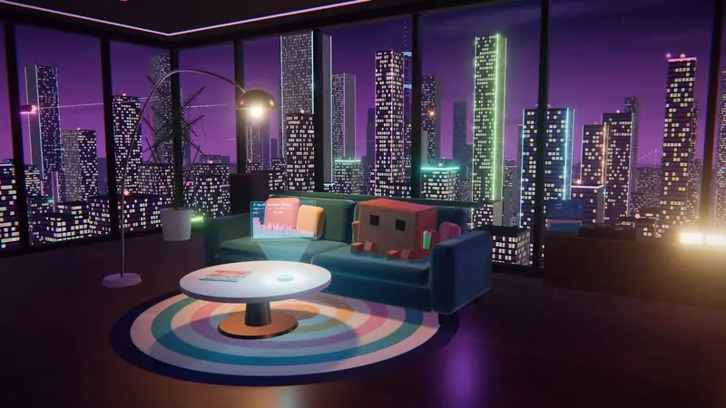
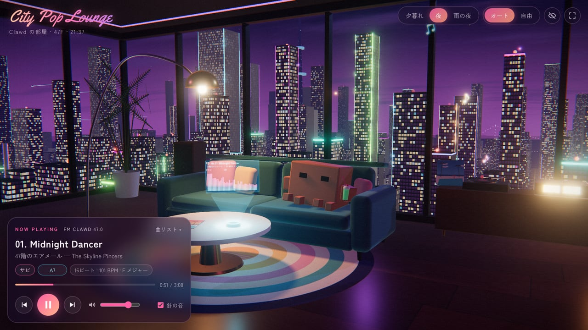
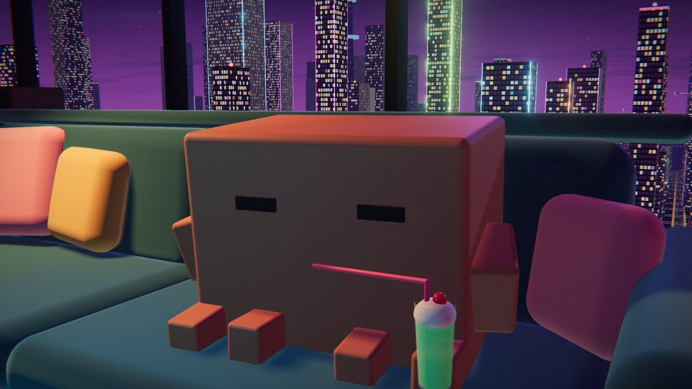
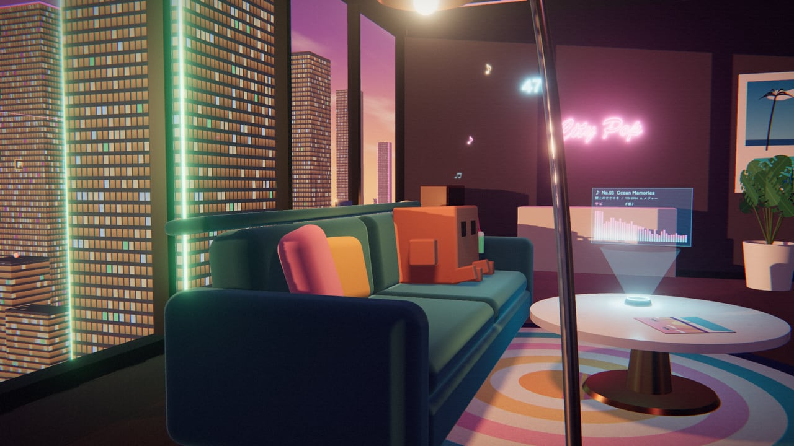
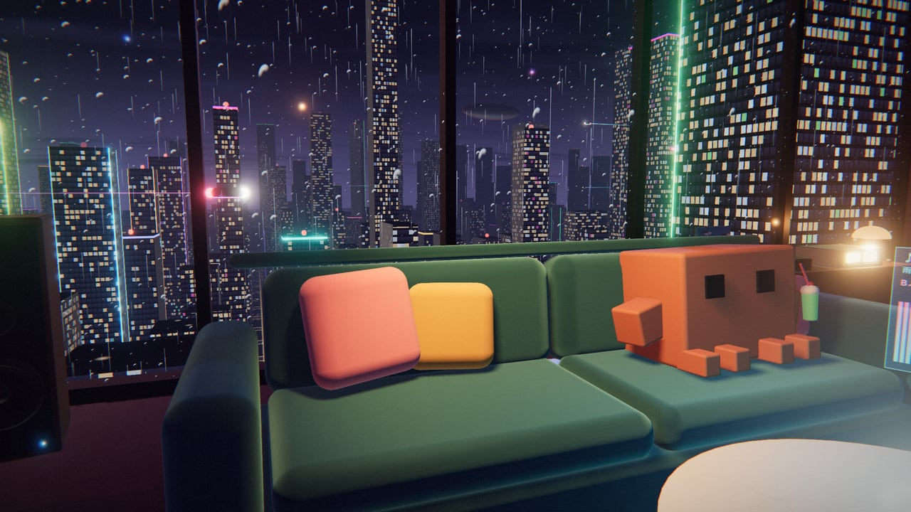
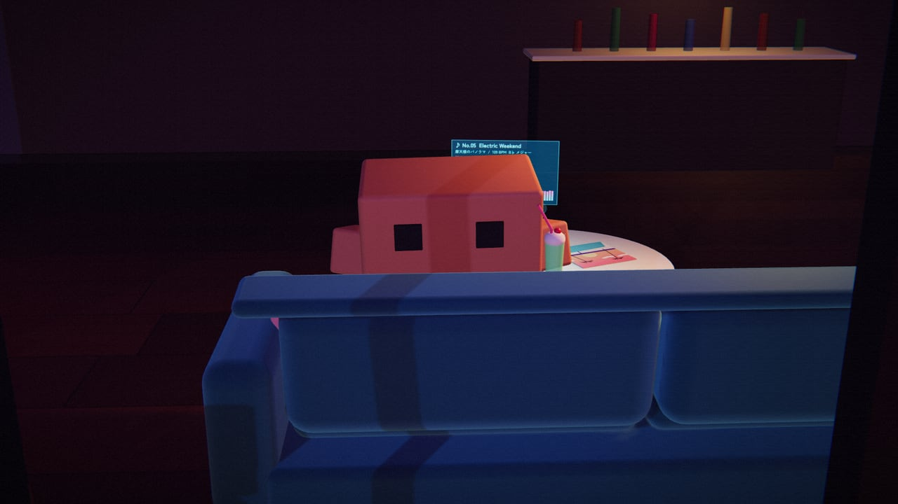
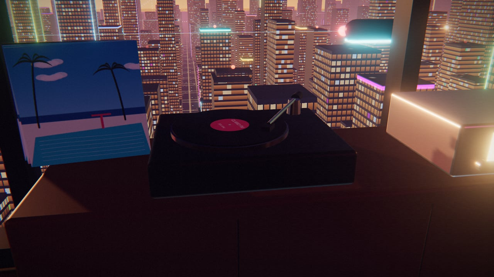
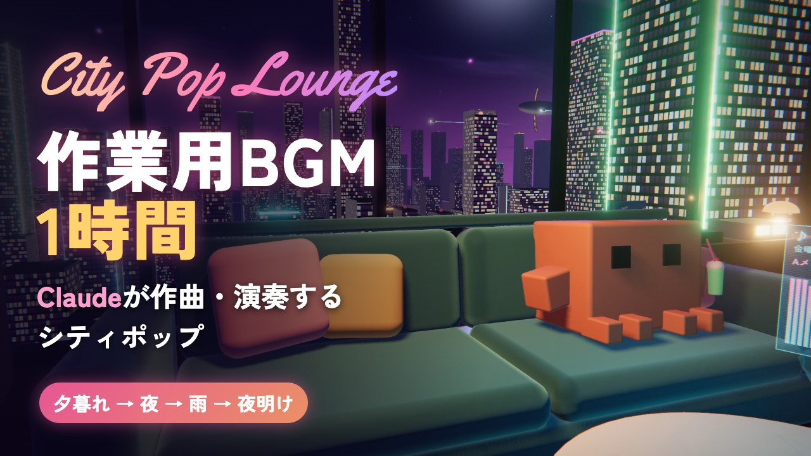

# City Pop Lounge — Clawd のシティポップ・ラウンジ

近未来の高層ビル 47 階のラウンジで、Clawd がシティポップを聴きながらくつろぐ様子を眺める、ブラウザの 3D アプリです。

[](https://tanuu5.github.io/clawd-city-pop-lounge/)
[](https://www.anthropic.com/claude)
[](./LICENSE)

<p align="center">
  
</p>

<p align="center"><b><a href="https://tanuu5.github.io/clawd-city-pop-lounge/">▶ ブラウザで開く</a></b>（インストール不要・音が出ます）　／　<b><a href="https://youtu.be/FQ4wE-IDKeE">▶ 作業用BGM 1時間（YouTube）</a></b></p>

**Claude Code × Claude Opus 5.5（XHIGH）** で作りました。

ゲームではなく、眺めて聴く作品です。流れる曲はその場で自動作曲し、Web Audio で合成しています（音声ファイルは使っていません）。部屋も夜景も Clawd も、すべてコードで作っています。時間帯は夕暮れ・夜・雨の夜・夜明けの 4 つで、カメラは曲のセクションの変わり目でカットを切り替えます。

## スクリーンショット

<table>
  <tr>
    <td width="50%"><br><sub>夜のラウンジ。再生カードには、曲名と今のセクション・コード名が出ます。</sub></td>
    <td width="50%"><br><sub>ときどきクリームソーダを飲みます。手が短いので、ストローのほうが伸びてきます。</sub></td>
  </tr>
  <tr>
    <td width="50%"><br><sub>夕暮れ。サビではスピーカーから音符が舞い、ホログラムに曲のスペクトルが映ります。</sub></td>
    <td width="50%"><br><sub>雨の夜。窓ガラスを雨粒が流れ、雨音も鳴ります。</sub></td>
  </tr>
  <tr>
    <td width="50%"><br><sub>間奏では振り返り、ソファの背から夜景を眺めます。カメラは窓の外から。</sub></td>
    <td width="50%"><br><sub>レコードは 33⅓ 回転。曲が進むと、トーンアームが内側へ寄っていきます。</sub></td>
  </tr>
</table>

画像と動画は、すべて実際の画面です（音楽を鳴らしながら撮りました）。

## 作業用 BGM の動画（YouTube）

このラウンジを 1 時間流しっぱなしにして録画した、作業用 BGM の動画です。夕暮れ → 夜 → 雨の夜 → 夜明けと時間が移り、全 20 曲が流れて、最後は Clawd が眠って終わります。

<p align="center">
  <a href="https://youtu.be/FQ4wE-IDKeE"></a>
</p>

<p align="center"><b><a href="https://youtu.be/FQ4wE-IDKeE">【作業用BGM】Claudeがその場で作曲したシティポップ 1時間｜夕暮れから夜明けまで</a></b></p>

## 使い方

「再生してくつろぐ」を押すと、レコードに針が落ちて曲が始まり、Clawd が目を覚まします。あとは眺めているだけです。

| 操作 | 動作 |
|---|---|
| Space | 再生／一時停止 |
| ← → | 前の曲／次の曲 |
| 1 2 3 4 | 夕暮れ／夜／雨の夜／夜明け |
| C | カメラ（オート／自由。自由ではドラッグで見回せます） |
| H | UI を隠す |
| M | 消音 |
| Clawd をクリック | 跳ねて喜びます |

画面右上のボタンでも、時間帯とカメラを切り替えられます。「曲リスト」から好きな曲を選べます。一時停止したまましばらくすると、Clawd は眠ってしまいます。

## 曲について

- 収録曲は 8 曲（16 ビート、ディスコ、メロウ、シャッフルの 4 スタイル）。8 曲目のあとは、新しい曲を作り続けます。同じ曲は、何度開いても同じように作られます。
- コード進行は、丸サ進行・王道進行・IV–ivm（サブドミナントマイナー）・ii–V などを組み合わせ、セクションの終わりは次のセクションへ導く和音（ドミナントや裏コード）に差し替えています。
- 構成はイントロ → A メロ → B メロ → サビ → 間奏 → … → ソロ → ラストサビ → アウトロ。曲によって、B メロの終わりに「キメ」が入ったり、ラストサビで半音・全音上に転調したりします。
- メロディは 2 小節のモチーフをくり返し・変形して作るので、サビは毎回同じフレーズに戻ってきます。
- 音色は、DX 系の FM エレピ、スラップ気味のベース、Karplus-Strong で弾くカッティングギター、シンセブラス、ストリングス、ゲートリバーブのスネアなど。
- 曲名とバンド名（The Skyline Pincers）は架空のものです。

## 制作について

企画・ディレクション：**たぬ**　／　開発：**Claude Code（Claude Opus 5.5・推論レベル XHIGH）**

作曲エンジン、音色の合成、部屋と夜景と Clawd の 3D、カメラ演出、UI まで、Claude Code が設計から実装まで進めました。見た目は、ヘッドレス Chrome（実 GPU）で撮った画面を見ながら直しています。Claude は音を聴けないので、曲はオフラインで書き出して音量のバランス・音割れ・メロディと伴奏の濁りを数値で確かめ、聴いた感想はたぬが伝えています。

## 更新履歴

- **2026-10-12**：作業用 BGM の動画（1 時間）を YouTube で公開
- **2026-10-11**：夜明けの時間帯と、作業用 BGM の動画を録るための動画モード（`?video=<分>`）を追加
- **2026-10-11**：公開

## 開発

```bash
npm install
npm run dev      # http://127.0.0.1:5183/
npm run build    # dist/ に書き出し
```

- `?dev` を付ける（開発サーバーでは常に）と、確認用のフック `window.__dev` が使えます（`__dev.goto('sunset')`、`__dev.goto('clawd')` など）。`?clean=1` で UI を隠します。
- `dev/audio-test.html`（開発サーバーのみ）で、曲の一部をオフラインで書き出して音量を測れます。
- `?video=60` は動画モードです。UI を出さずに自動で再生し、60 分かけて時間帯を夕暮れ → 夜 → 雨の夜 → 夜明けと移し、曲名を画面に重ねます。終わりが近づくと今の曲の終わりで止まり、Clawd が眠ってから暗転します。
- `caffeinate -dims node dev/record-video.mjs --minutes 60` で、動画モードをヘッドレス Chrome で開き、映像と音を実時間で録画します（開発サーバーを起動しておく。`shots/video/` に MP4 とチャプター一覧ができます）。Chrome の MP4 録画はファイルが 4GB を超えると止まるので、ビットレートは長さから 4GB に収まる値を自動で選びます。止まったときは見張りが気づいて終了し、`--from <秒> --track <曲>` で続きだけを録ってつなげます。

| ファイル | 中身 |
|---|---|
| `src/audio/composer.js` | シードから曲を組み立てる（構成・コード進行・メロディ・各楽器のパターン） |
| `src/audio/instruments.js` | 楽器の合成（FM エレピ、ベース、ギター、ドラムなど） |
| `src/audio/engine.js` | 先読みスケジューラ、ミキサー、リバーブ・ディレイ・コーラス |
| `src/scene/clawd.js` | Clawd のモデルと動き |
| `src/scene/room.js` / `city.js` | 部屋と、窓の外の街・空・雨 |
| `src/scene/director.js` | カメラのショットと切り替え |

## GitHub Pages で公開する

`main` に push すると、GitHub Actions（`.github/workflows/deploy.yml`）がビルドして GitHub Pages に公開します。初回だけ、リポジトリの Settings → Pages → Source を「GitHub Actions」にします。

## クレジット・ライセンス

- コード：MIT License（[LICENSE](LICENSE)）© 2026 たぬ
- 3D 描画：[three.js](https://threejs.org/)（MIT License）
- フォント：[Yellowtail](https://fonts.google.com/specimen/Yellowtail)（Apache License 2.0）、[Zen Kaku Gothic New](https://fonts.google.com/specimen/Zen+Kaku+Gothic+New)（SIL Open Font License 1.1）。Google Fonts から読み込んでいます（リポジトリには含めていません）。
- 曲・効果音・画像は、すべてこのリポジトリのコードがその場で生成しています。既存の曲のメロディや音源は使っていません。
- **Clawd について**：Clawd は Anthropic の Claude Code のマスコットです。この作品の Clawd は、その姿をもとにした二次創作（ファンアート）で、Anthropic の公式のものではなく、Anthropic とは関係ありません。キャラクターの権利は Anthropic にあり、MIT License の対象外です。
- MIT License の対象は、このリポジトリのコードと文章です。「Claude」「Clawd」の名前や商標の使用を許諾するものではありません。
